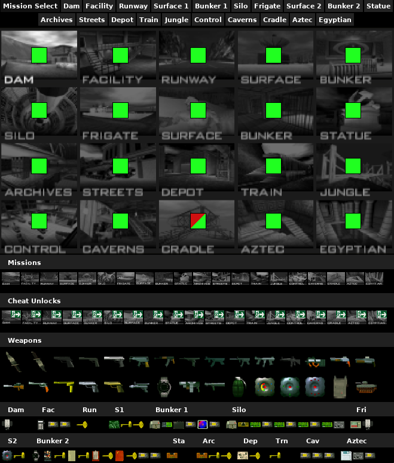

### GoldenEye 007 tracker pack for [PopTracker](https://github.com/black-sliver/PopTracker/) with auto-tracking, made by VincentsSin.

PopTracker 0.32.0 is the earliest fully functional version. Any previous one will lack the latest features and some operations might not function properly.

## Installation
- Download [PopTracker](https://github.com/black-sliver/PopTracker/releases/latest) and extract (unzip) it. It may be installed anywhere, but avoid installing it in either `Program Files` or `Program Files (x86)` (these directories have some special permissions, which might cause issues).
- [Download the latest release from source](https://github.com/VincentsSin/Goldeneye007-AP-Tracker/releases/latest) and move the `.zip` file into the `packs` folder, located inside the PopTracker directory.
  - Alternatively, it can be dragged on top of a PopTracker window, which will give a prompt to install the pack.

## Autotracking
1. Click the grey `AP` button in the top left of the window; A new window will open.
2. In the new window, type the server's host (`archipelago.gg` or `localhost`), followed by `:`, then the port (represented by five numbers and are unique to the session). Click `OK`.
3. Enter the slot name. This is the player name that was written in the yaml used to generate. Click `OK`.
4. If applicable, enter the password. Click `OK`.

If entered correctly, the `AP` button will turn green, meaning it is connected to the server and is autotracking. If it remains red, make sure the server is opened or that your port number has not changed.

## About This Pack
This is a tracker intended for use with the [GoldenEye 007 Archipelago](https://github.com/NotFamilyJules/goldeneye_ap) randomizer by FamilyJules. Features include the following:
- 1:1 remastered maps pulled from the official player's guide.
- Auto-tabbing for switching maps as you enter a new mission.
- Key item grouping by the mission(s) they are intended, rather than one bulk display.
- Compact broadcast view for streamers & laptop users to display maps and item tracking w/o the large real estate of the standard view.
- Static enemy markers for each mission map. Plan your stealth more accordingly!
- Per-mission target time display for you crazies willing to do cheat unlocks as checks.

## Special Thanks
Huge thank you to FamilyJules for not only assisting with the more technical aspects of making the pack work, but for also including me in the overall process after asking to build off my Manual APworld for GoldenEye. This whole process has been a fun learning experience, and I'm excited to see how we can make this grow!

If you encounter any bugs or have any questions, feel free to ask by pinging the maintainer on Discord (@VincentsSin), preferably in the [Archipelago](https://discord.gg/archipelago) server in the `Goldeneye 007` channel.
